# Site de casamento bilíngue · Clara & Theo (demo)

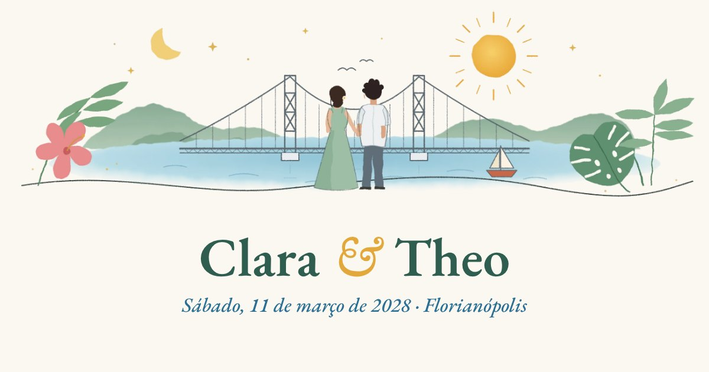

Site de casamento **bilíngue (PT/EN)** feito para convidados de dois países. Ele junta tudo o que o convidado precisa em um só lugar e dá ao casal um **painel privado** para acompanhar as confirmações em tempo real.

> **Projeto demonstrativo.** Esta é a versão pública e anônima de um site feito para clientes reais. Nomes, datas, local, história e dados de convidados foram substituídos por **conteúdo fictício**.

**[▶ Ver o site funcionando](https://casamento-clara-theo.pages.dev)** · Para testar o painel dos noivos, abra `#painel` e digite qualquer código.

---

## Funcionalidades

| Para os convidados | Para o casal |
|---|---|
| Site em **português e inglês**, troca com um toque | **Painel privado** (`#painel`) protegido por código |
| Contagem regressiva e resumo do evento | Totais: pessoas confirmadas, quem vai e quem não vai |
| **Salvar na agenda** (Google Agenda e arquivo `.ics` para iPhone/Outlook) | Lista com busca e filtros, **exportação em CSV** |
| **Confirmação de presença** com acompanhantes e restrições alimentares | Botão para copiar as restrições alimentares e enviar ao buffet |
| **E-mail automático** de confirmação para o convidado | **E-mail de aviso** a cada nova confirmação |
| Guia da cidade com fotos, passeios, restaurantes, dicas práticas e mapa | Respostas salvas automaticamente no **Google Sheets** |
| Hospedagem: casas, hotéis e buscas no Airbnb já com as datas | Bloqueio após tentativas erradas de código |
| Presentes via **PIX** (QR code e copia e cola) | Prazo de confirmação que fecha o formulário sozinho |

## Telas

| Início (desktop) | Início (celular) |
|---|---|
| 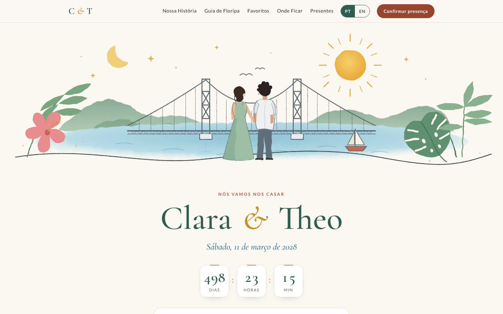 | 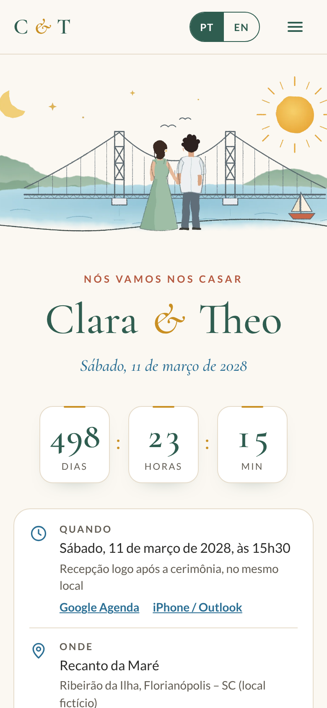 |

| Guia da cidade | Favoritos |
|---|---|
| 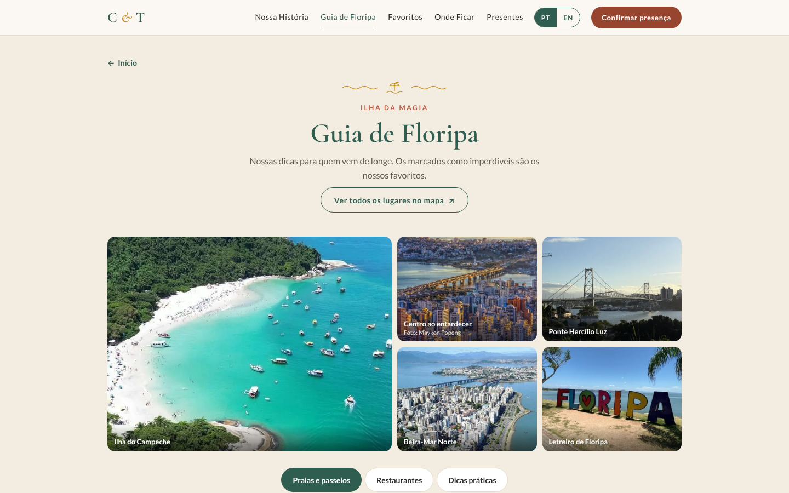 | 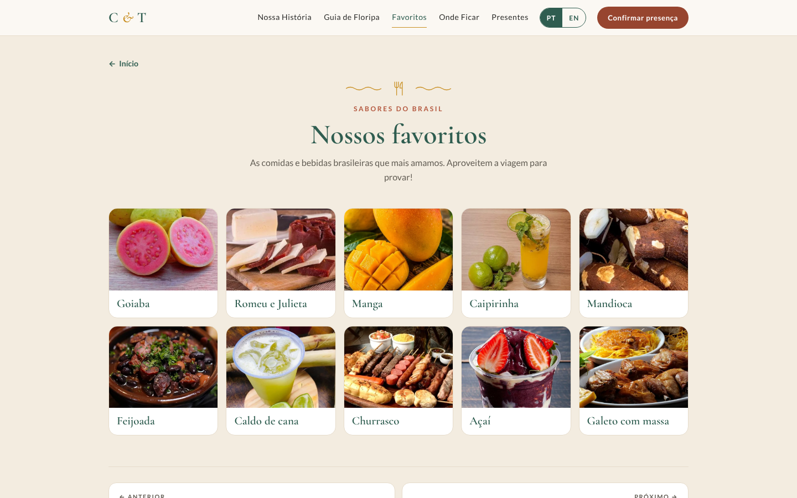 |

| Painel dos noivos | E-mail de confirmação |
|---|---|
| 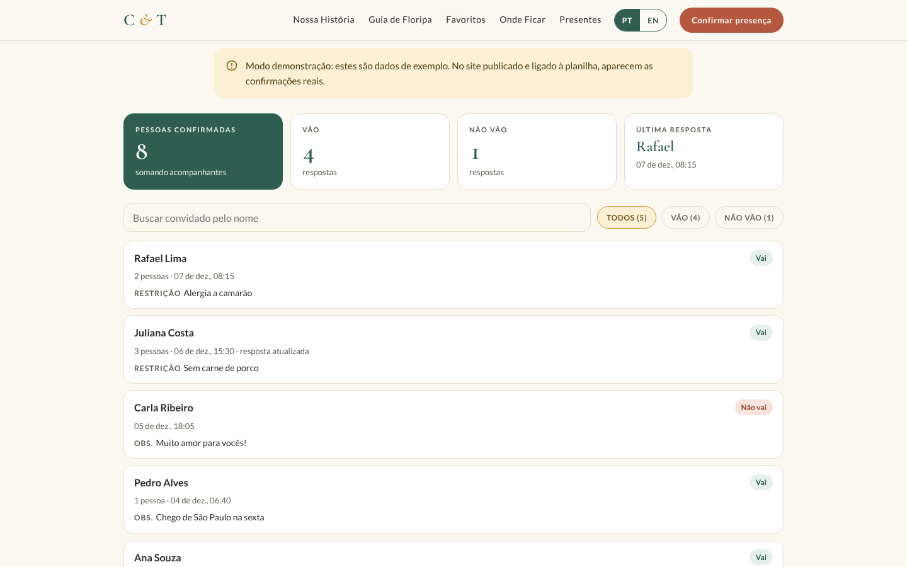 | 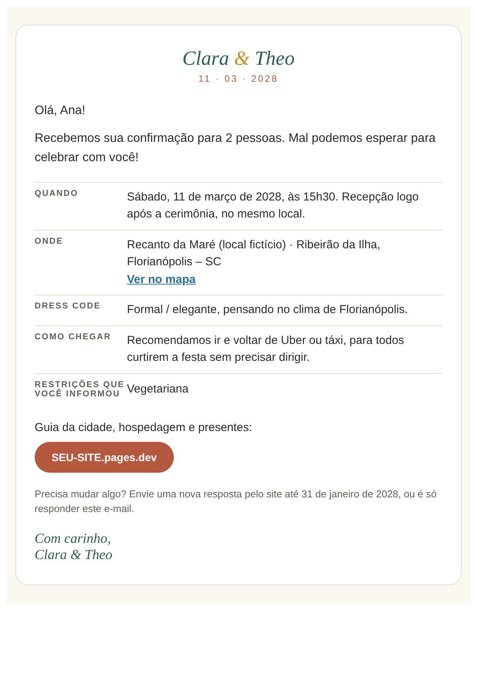 |

| Nossa História | Confirmação | Presentes |
|---|---|---|
| 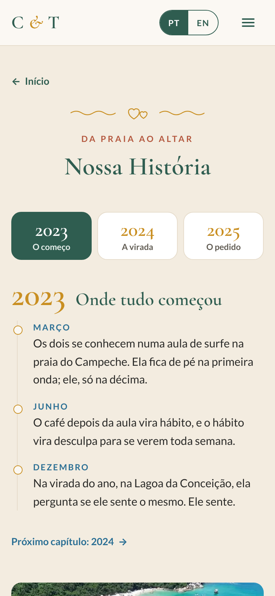 | 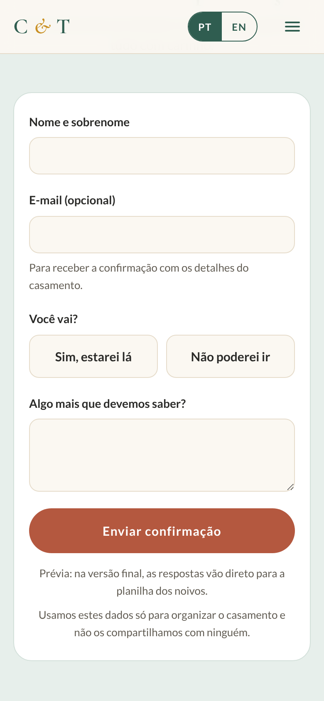 | 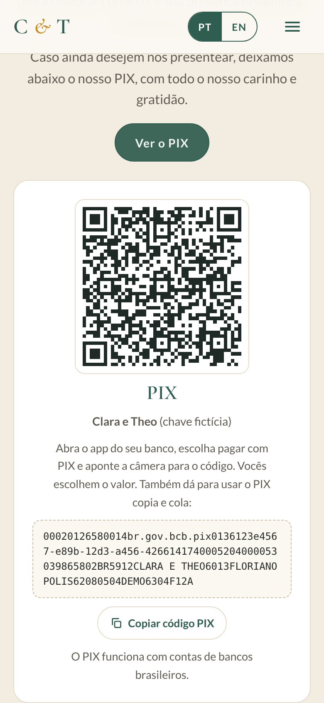 |

Versão em inglês: [docs/screenshots/inicio-desktop-en.png](docs/screenshots/inicio-desktop-en.png)

## Como funciona

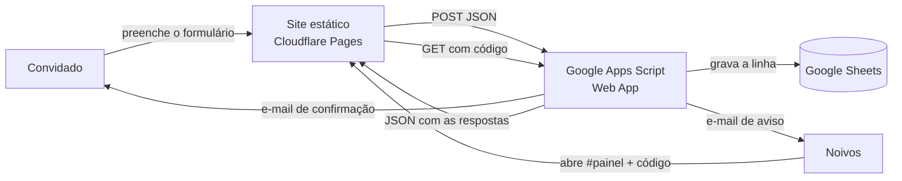

- **Front-end:** um único `index.html` com HTML, CSS e JavaScript puros, sem framework e sem etapa de build.
- **Back-end sem servidor:** um Web App do Google Apps Script recebe as respostas, grava na planilha, envia os e-mails e serve os dados do painel.
- **Hospedagem:** arquivos estáticos (Cloudflare Pages ou GitHub Pages), sem custo.
- **Modo demonstração:** com `RSVP_ENDPOINT` vazio, o formulário funciona sem enviar nada e o painel mostra dados de exemplo. É assim que este repositório roda.

## Decisões técnicas

- **Navegação por telas**, com roteamento por `#hash`, transições suaves e "Anterior / Próximo". O convidado abre só o que precisa, sem uma página longa para rolar.
- **Bilíngue sem duplicar páginas:** cada texto tem as versões `data-l="pt"` e `data-l="en"`, e o idioma é detectado pelo navegador.
- **Pensado para celular:** áreas de toque com pelo menos 40 px, campos que não dão zoom no iPhone, layout testado de 320 a 1440 px.
- **Leve:** imagens em WebP com `loading="lazy"`; as fotos da cidade e da comida só carregam quando a tela é aberta.
- **Acessível:** abas com `role="tab"` e `aria-selected`, textos alternativos, contraste adequado e foco visível.
- **Segurança do painel:** o código é conferido no servidor, com bloqueio de 10 minutos após 20 tentativas erradas (`CacheService`). O formulário tem um campo anti-spam escondido, e textos que começam com `=`, `+`, `-` ou `@` são neutralizados antes de ir para a planilha.
- **Privacidade:** o site real usou `noindex` para não aparecer no Google, e o formulário avisa como os dados são usados.
- **PIX:** BR Code estático gerado com CRC16 e QR em SVG. Nesta demo a chave é fictícia.
- **Tipografia:** a Cormorant Garamond desenha o acento circunflexo com defeito, então â/ê/ô usam a EB Garamond via `unicode-range`.

## Rodando localmente

Não precisa instalar nada:

```bash
git clone https://github.com/SEU-USUARIO/site-casamento-bilingue.git
cd site-casamento-bilingue
python3 -m http.server 8080   # ou abra o index.html direto no navegador
```

Acesse `http://localhost:8080`. O painel fica em `http://localhost:8080/#painel`, e qualquer código entra no modo demo.

## Ligando a uma planilha de verdade

O passo a passo completo (Google Sheets, Apps Script, e-mails e deploy) está em **[docs/SETUP.md](docs/SETUP.md)**. Em resumo:

1. Crie uma planilha e cole [`apps-script/Code.gs`](apps-script/Code.gs) em *Extensões → Apps Script*.
2. Configure o e-mail dos noivos e o código do painel, e implante como *App da Web*.
3. Cole a URL `/exec` em `var RSVP_ENDPOINT='...'` no `index.html`.
4. Publique a pasta no Cloudflare Pages ou no GitHub Pages.

## Estrutura

```
├── index.html              # o site inteiro (HTML + CSS + JS)
├── apps-script/Code.gs     # back-end: planilha, e-mails e painel
├── img/                    # ilustração, fotos (WebP) e ícone
├── fonts/                  # EB Garamond (correção do circunflexo)
├── casamento.ics           # evento para iPhone/Outlook
├── og.jpg                  # prévia ao compartilhar o link
├── docs/
│   ├── SETUP.md            # instalação passo a passo
│   ├── ESTUDO-DE-CASO.md   # o projeto contado para portfólio
│   ├── ilustracao-fonte.svg
│   └── screenshots/
└── LICENSE
```

## Escopo do projeto

Projeto real, de ponta a ponta:

1. **Briefing** com os clientes e levantamento de conteúdo.
2. **Proposta visual** (identidade, paleta, tipografia e telas) apresentada e aprovada antes do desenvolvimento.
3. **Design responsivo** pensado primeiro para celular.
4. **Desenvolvimento** front-end em HTML, CSS e JavaScript puros.
5. **Back-end sem servidor** com Google Apps Script, Google Sheets e e-mails automáticos.
6. **Painel privado** para os clientes acompanharem as confirmações.
7. **Publicação** no Cloudflare Pages com domínio próprio.
8. **Entrega**: QR code para o convite, guia de uso do painel e instruções de manutenção.

## Tecnologias

`HTML5` · `CSS3` · `JavaScript (vanilla)` · `Google Apps Script` · `Google Sheets` · `MailApp` · `Cloudflare Pages` · `WebP` · `iCalendar (.ics)` · `PIX BR Code`

## Imagens e licença

- O **código** está sob a [licença MIT](LICENSE).
- A **ilustração** desta demo é original, feita para este repositório, e o arquivo-fonte está em [`docs/ilustracao-fonte.svg`](docs/ilustracao-fonte.svg).
- As **fotos de Florianópolis e das comidas** são de terceiros e aparecem só para demonstração; os direitos pertencem aos autores. Foto do Centro ao entardecer: Maykon Popeng. Elas **não** estão cobertas pela licença MIT. Para reutilizar o projeto, troque-as por fotos próprias ou de bancos gratuitos.

---

## English summary

A **bilingual (PT/EN) wedding website** with an RSVP form backed by Google Sheets, automatic confirmation emails and a private dashboard for the couple. It is plain HTML/CSS/JS in a single file, with a serverless back end on Google Apps Script and static hosting on Cloudflare Pages.

This is an **anonymized demo** of a site built for real clients: all names, dates, places and guest data are fictional. With `RSVP_ENDPOINT` empty, the site runs in demo mode: the form works without sending data, and the dashboard (`#painel`, any code) shows sample data. Setup guide: [docs/SETUP.md](docs/SETUP.md).

End-to-end scope: client briefing, visual proposal, responsive design, front-end development, serverless back end (Apps Script + Sheets + emails), private dashboard, deployment with a custom domain and client handover.
